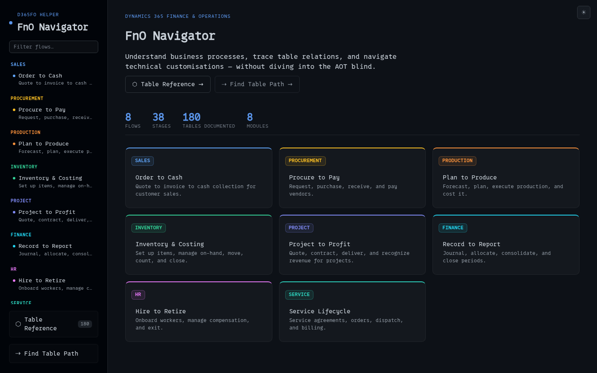
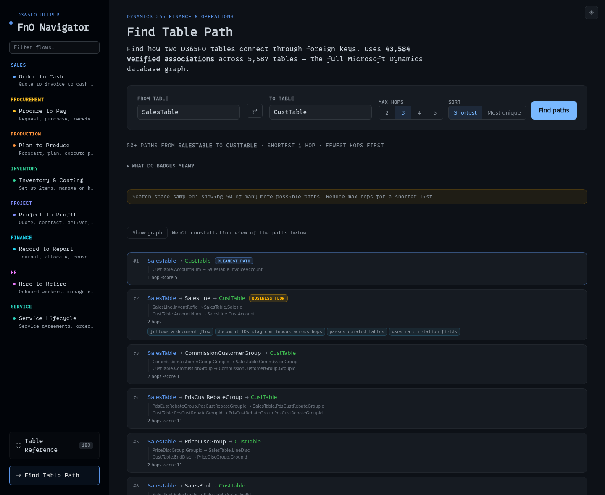
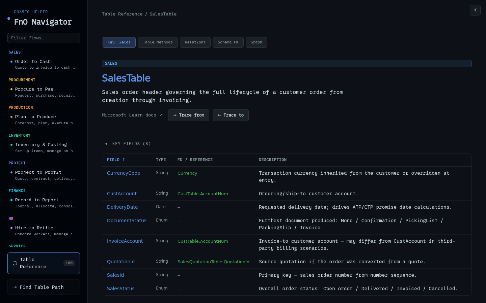

# FnO Navigator

A static reference for Dynamics 365 Finance and Operations (D365FO): which tables sit behind each business process, what those tables contain, and how one table reaches another through foreign keys.

Live at https://fno.hidayattaufiqur.dev

## Screenshots


Eight end-to-end flows, each split into stages with roles, menu paths, tables and Learn links.


Ranked foreign-key paths between two tables, with a reason code behind each rank and a constellation view of the result.


One table: key fields, inherited xRecord methods, relations, schema foreign keys and the graph tab.

## The problem

"Which tables back this process" is a question about the data model, and the model is not organised the way the question is asked. The AOT groups everything by object type: tables under tables, forms under forms. The question is grouped by business process.

- Visual Studio and the AOT expose every table, field and relation at once, so getting from a process name down to the handful of tables that take part in it is manual filtering.
- Table relations are spread across form designs, ERD documents, Microsoft Learn pages and the relation metadata on the tables themselves. Following a foreign-key chain by hand means visiting each of those places in turn.
- On a new project, or in a module you have not worked in before, that detour happens before any of the actual work starts.

This project answers three questions without a Visual Studio session: which tables take part in a process, what a given table contains and connects to, and how one table reaches another through foreign keys.

## What it does

Three routes, one per question:

- `/` lists the flows; each opens at `/flow/[flowId]` with its stages in order.
- `/tables` is the browsable reference; a table opens at `/tables/[name]`.
- `/find` is the Table Path Finder.

### Process flows

8 end-to-end flows across 8 modules: Order to Cash (`otc`, Sales), Procure to Pay (`p2p`, Procurement), Plan to Produce (`ptp`, Production), Inventory & Costing (`inv`, Inventory), Project to Profit (`proj`, Project), Record to Report (`rtr`, Finance), Hire to Retire (`hr`, HR) and Service Lifecycle (`service`, Service).

38 documented stages. Each stage carries its roles, menu paths, Microsoft Learn doc links, prerequisites, pitfalls and involved tables. 34 of 38 also carry table-to-table relations, and 12 carry approval steps.

What one stage looks like, excerpted from the first Order to Cash stage:

```text
Create Quote
  roles       Sales
  menu path   Sales and marketing > Sales quotes > All sales quotes
  tables      SalesQuotationTable, SalesQuotationLine, CustTable,
              PriceDiscTable, PriceDiscAdmTrans
  relations   SalesQuotationTable.CustAccount -> CustTable.AccountNum
              SalesQuotationLine.QuotationId -> SalesQuotationTable.QuotationId
  approvals   Quote approval workflow
```

### Table reference

180 documented tables (`tableDefs`), with 1,449 field entries that carry plain-English notes, 294 explicit foreign-key references and 178 Microsoft Learn doc links. Each table also gets the 64 Common and xRecord inherited methods, with signatures and descriptions, grouped into CRUD, validation, init, events, data access, utility and static.

Every table page has tabs for key fields, table methods, relations, schema foreign keys and the graph.

### Table Path Finder

The path finder searches for foreign-key paths between any two tables. Paths are ranked by quality class, then score, then hop count, and every rank carries a reason code that says why it landed there. Sort modes are Shortest and Most unique; max hops is adjustable from 2 to 5. A WebGL constellation view renders the result paths in 3D.

One measured run: SalesTable to CustTable returns 50+ paths, the shortest being 1 hop (`CustTable.AccountNum` to `SalesTable.InvoiceAccount`).

## Scope and limitations

- The foreign-key graph is only as complete as the public dataset it is generated from. A table missing from it can be reported from inside the app through the "report a missing table" link, which opens an issue. Gaps get closed by patching the public dataset upstream, never by adding licensed D365FO standard-source material to this repository.
- Ranked paths are a heuristic ordering of real foreign-key hops. A high rank does not assert that the path is the intended business route through the system.
- 180 tables are documented against a dataset of 5,587. Which tables made the cut was a manual decision, so treat the reference as a hand-picked subset rather than a map of the whole product.
- There is no offline mode yet, and the content is English only. This project is not affiliated with or endorsed by Microsoft. D365FO as a product is licensed by Microsoft; this repository ships only MIT-licensed derived data.

## Quick start

The commands below were run green against `main`. CI builds on Node 22, and the repo commits its lockfile, so install with `npm ci`. You need Node 22 and npm on the machine; nothing else is required to build or preview.

```sh
npm ci                 # install (package-lock committed)
npm run dev            # Vite dev server
npm run build          # static build -> build/
npm run preview        # preview the production build
npm run verify:map     # dataset fingerprint + counts + source sha read-back
```

Stack: SvelteKit 2 with `adapter-static` (`fallback: 'index.html'`), Svelte 5, Vite 7, and TypeScript data-as-code for the flow and table definitions. The 2D graph uses Sigma 3, Graphology 0.26 and ForceAtlas2; the 3D view uses 3d-force-graph 1.80 and three 0.185.

The site is a client-rendered SPA (`ssr = false`, `prerender = false`), so the build emits a single `build/index.html` plus hashed assets. It is served as static files from the author's own host. Any static host works provided unknown paths fall back to `index.html`. Without that fallback, deep links such as `/tables/SalesTable` return 404.

`static/fonts/` is gitignored, so a fresh clone builds and runs fine but falls back to a system monospace stack instead of 0xProto.

Where the pieces live:

- `src/routes/` holds the pages. The curated content lives in `src/lib/data/flows.ts` and `src/lib/data/tableMethods.js`, stored as data rather than fetched at runtime.
- `src/lib/pathfinder.js` and `src/lib/pathScoring.js` do the search and the ranking.
- `static/data/fk-map.json` is the generated graph; `static/data/map-manifest.json` is its provenance record.
- `tools/generate-map.mjs` regenerates both.

CI (`.github/workflows/ci.yml`) covers the build, the dataset fingerprint, and the fixture, golden and performance checks (unique-mode p95 within a 300 ms budget).

## Data provenance and regeneration

`static/data/fk-map.json` holds the graph the path finder searches.

- 5,587 tables (parent keys) and 43,616 directed foreign-key edges.
- Source: Alex Meyer's `MicrosoftDynamicsTableAssociations`, file `tablefieldassociations.json`, 39,113 entries, 7,534,941 bytes, content sha256 `33b670264b47…`, dataset commit `af2a7c3`.
- Transform: 32,344 single-field relations emitted as-is; 6,701 composite or multi-field specs expanded into 11,272 one-edge-per-field-pair edges; 25 marker-only specs (`Pky?`/`Fky?`) dropped; 486 duplicate edges deduped. That leaves 48 connected components and 0 orphan tables.
- Schema: `{ parentTable: [[childTable, parentField, childField], ...] }`.

`tools/generate-map.mjs` (generator v1.0.0) rebuilds the map deterministically: same input, byte-identical outputs, in any environment. `static/data/map-manifest.json` records the source commit and sha256, the transform counts and a fingerprint, and `npm run verify:map` re-checks that fingerprint and the counts against the committed files. Regeneration means running that generator against a checkout of the upstream dataset; `verify:map` is the check that the output still matches what is committed.

## Attribution and license

MIT. See `LICENSE`, copyright 2026 Hidayat Taufiqur. Source: https://github.com/hidayattaufiqur/fno-navigator

The relationship data originates as HTML ERD files Microsoft published in `Microsoft/ax-2012-doc-tools` (https://github.com/Microsoft/ax-2012-doc-tools). Alex Meyer's `MicrosoftDynamicsTableAssociations` project (https://github.com/ameyer505/MicrosoftDynamicsTableAssociations) restructured those into the JSON this repo consumes, and it is the sole data source for `static/data/fk-map.json`. Both upstream projects are MIT licensed; the derived data here is redistributed under the same MIT terms with that attribution preserved.

## Contributing

See `CONTRIBUTING.md` for issue and pull request guidelines, branch naming and commit style.
